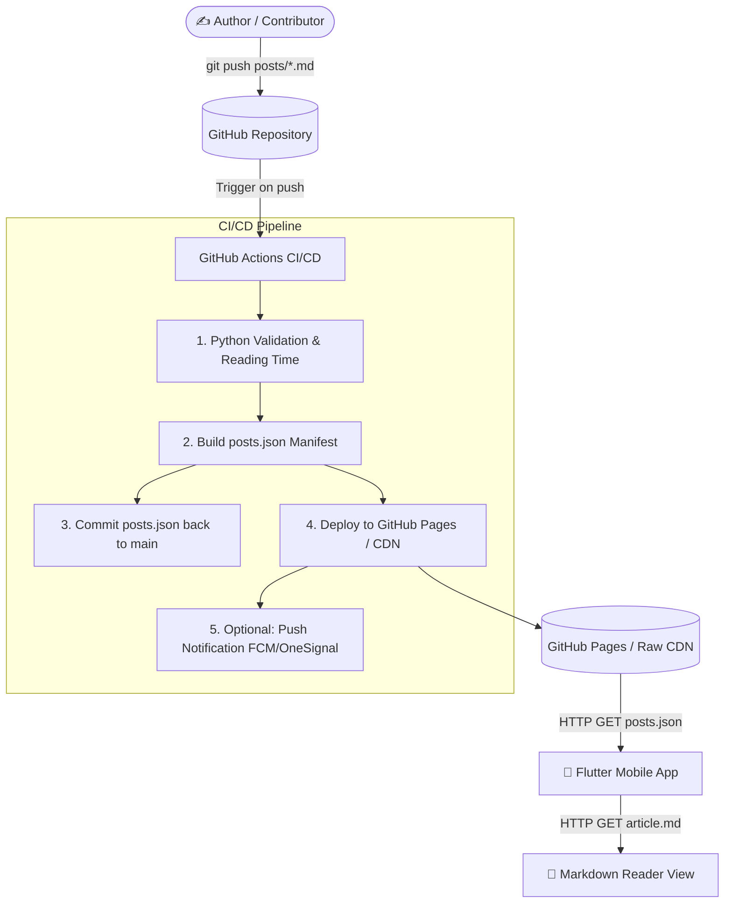

# 📝 Git-Based Serverless Headless CMS

A lightweight, serverless, Git-driven Headless CMS built on GitHub, GitHub Actions, and GitHub Pages to deliver blog articles to Flutter mobile applications.

Authors write standard Markdown (`.md`) files in `posts/`. On every `git push`, a GitHub Actions CI/CD workflow validates the frontmatter, computes reading time, resolves asset paths, compiles a structured `posts.json` manifest, auto-commits the index, and publishes everything to GitHub Pages.

---

## 🏛️ Architecture Overview



---

## 📁 Repository Structure

```text
.
├── .github/
│   └── workflows/
│       └── deploy.yml              # Automated build, commit & deployment workflow
├── images/                         # Banners and illustrations referenced in posts
│   ├── banner-philosophy.svg
│   └── banner-puya.svg
├── posts/                          # Blog articles written in Markdown
│   ├── manipur-puya-ancient-wisdom.md
│   └── philosophy-of-time.md
├── scripts/
│   └── generate_index.py           # Python automation script
├── posts.json                      # Generated index manifest consumed by Flutter
├── requirements.txt                # Optional dependencies for PyYAML/frontmatter
└── README.md                       # Documentation & Flutter integration guide
```

---

## ✍️ Frontmatter Specification

Every article in `posts/*.md` must start with YAML frontmatter:

```yaml
---
id: "unique-slug-id"
title: "Article Title"
summary: "Short 2-line summary for mobile list cards"
date: "YYYY-MM-DD"
author: "Author Name"
category: "Philosophy" # e.g. Philosophy, Culture, History, Science
thumbnail: "images/banner.svg"
language: "en" # "en" (English) or "mni" (Meetei Mayek)
featured: true # true or false
---

# Article Content Begins Here...
```

### Field Definitions:

| Field | Type | Required | Description |
| :--- | :--- | :--- | :--- |
| `id` | `string` | **Yes** | Unique URL-friendly slug. |
| `title` | `string` | **Yes** | Title of the article. |
| `summary` | `string` | **Yes** | Brief overview displayed in card feeds. |
| `date` | `string` | **Yes** | Publication date in `YYYY-MM-DD` format (used for descending sort). |
| `author` | `string` | **Yes** | Name of the author. |
| `category`| `string` | **Yes** | Classification tag. |
| `thumbnail`| `string` | **Yes** | Relative path to image (e.g. `images/banner.svg`). |
| `language`| `string` | **Yes** | Language code (`en`, `mni`, etc.). |
| `featured`| `boolean`| No | Highlights the article at the top of the feed (`true`/`false`). |

---

## 📦 Generated `posts.json` Output Format

The Flutter app queries this single JSON endpoint to populate its home feed:

```json
[
  {
    "id": "manipur-puya-ancient-wisdom",
    "title": "ꯄꯨꯌꯥꯒꯤ ꯋꯥꯈꯜꯂꯣꯟ: Wisdom of Ancient Manipuri Puya Manuscripts",
    "summary": "Exploring the indigenous historical manuscripts of Kangleipak, preserved in Meetei Mayek script, detailing cosmology, natural medicine, and ethics.",
    "date": "2026-09-18",
    "author": "Arnold CD",
    "category": "Culture",
    "thumbnail_url": "https://raw.githubusercontent.com/Arnold-cd/blog-cms/main/images/banner-puya.svg",
    "content_url": "https://raw.githubusercontent.com/Arnold-cd/blog-cms/main/posts/manipur-puya-ancient-wisdom.md",
    "reading_time_min": 2,
    "language": "mni",
    "featured": false
  },
  {
    "id": "philosophy-of-time",
    "title": "The Architecture of Subjective Time: Why Moments Stretch and Years Fly",
    "summary": "An inquiry into chronological physics versus phenomenological duration, and how human consciousness constructs the illusion of temporal flow.",
    "date": "2026-09-15",
    "author": "Arnold CD",
    "category": "Philosophy",
    "thumbnail_url": "https://raw.githubusercontent.com/Arnold-cd/blog-cms/main/images/banner-philosophy.svg",
    "content_url": "https://raw.githubusercontent.com/Arnold-cd/blog-cms/main/posts/philosophy-of-time.md",
    "reading_time_min": 3,
    "language": "en",
    "featured": true
  }
]
```

---

## 📱 Flutter Client Integration

### 1. Add Dependencies in `pubspec.yaml`
```yaml
dependencies:
  flutter:
    sdk: flutter
  http: ^1.2.1
  flutter_markdown: ^0.7.3
  flutter_svg: ^2.0.10+1
```

### 2. Dart Data Model (`blog_post.dart`)
```dart
class BlogPost {
  final String id;
  final String title;
  final String summary;
  final DateTime date;
  final String author;
  final String category;
  final String thumbnailUrl;
  final String contentUrl;
  final int readingTimeMin;
  final String language;
  final bool featured;

  BlogPost({
    required this.id,
    required this.title,
    required this.summary,
    required this.date,
    required this.author,
    required this.category,
    required this.thumbnailUrl,
    required this.contentUrl,
    required this.readingTimeMin,
    required this.language,
    required this.featured,
  });

  factory BlogPost.fromJson(Map<String, dynamic> json) {
    return BlogPost(
      id: json['id'] as String,
      title: json['title'] as String,
      summary: json['summary'] as String,
      date: DateTime.parse(json['date'] as String),
      author: json['author'] as String,
      category: json['category'] as String,
      thumbnailUrl: json['thumbnail_url'] as String,
      contentUrl: json['content_url'] as String,
      readingTimeMin: json['reading_time_min'] as int? ?? 1,
      language: json['language'] as String? ?? 'en',
      featured: json['featured'] as bool? ?? false,
    );
  }
}
```

### 3. Fetch Posts Service (`blog_service.dart`)
```dart
import 'dart:convert';
import 'package:http/http.dart' as http;
import 'blog_post.dart';

class BlogService {
  static const String postsJsonUrl =
      'https://raw.githubusercontent.com/Arnold-cd/blog-cms/main/posts.json';

  /// Fetches the index of all blog articles
  Future<List<BlogPost>> fetchPosts() async {
    final response = await http.get(Uri.parse(postsJsonUrl));
    if (response.statusCode == 200) {
      final List<dynamic> body = json.decode(utf8.decode(response.bodyBytes));
      return body.map((item) => BlogPost.fromJson(item)).toList();
    } else {
      throw Exception('Failed to load blog posts: ${response.statusCode}');
    }
  }

  /// Fetches raw markdown content for an individual article
  Future<String> fetchArticleMarkdown(String contentUrl) async {
    final response = await http.get(Uri.parse(contentUrl));
    if (response.statusCode == 200) {
      final raw = utf8.decode(response.bodyBytes);
      // Strip YAML frontmatter before displaying
      final cleanMarkdown = raw.replaceFirst(RegExp(r'^---[\s\S]*?---\s*'), '');
      return cleanMarkdown;
    } else {
      throw Exception('Failed to load article content');
    }
  }
}
```

### 4. Article Reader Screen (`article_screen.dart`)
```dart
import 'package:flutter/material.dart';
import 'package:flutter_markdown/flutter_markdown.dart';
import 'blog_post.dart';
import 'blog_service.dart';

class ArticleScreen extends StatelessWidget {
  final BlogPost post;
  const ArticleScreen({Key? key, required this.post}) : super(key: key);

  @override
  Widget build(BuildContext context) {
    return Scaffold(
      appBar: AppBar(title: Text(post.category)),
      body: FutureBuilder<String>(
        future: BlogService().fetchArticleMarkdown(post.contentUrl),
        builder: (context, snapshot) {
          if (snapshot.connectionState == ConnectionState.waiting) {
            return const Center(child: CircularProgressIndicator());
          }
          if (snapshot.hasError) {
            return Center(child: Text('Error: ${snapshot.error}'));
          }
          return Markdown(
            data: snapshot.data ?? '',
            selectable: true,
            styleSheet: MarkdownStyleSheet.fromTheme(Theme.of(context)).copyWith(
              h1: const TextStyle(fontSize: 26, fontWeight: FontWeight.bold),
              p: const TextStyle(fontSize: 16, height: 1.6),
            ),
          );
        },
      ),
    );
  }
}
```

---

## 🛠️ Local Development & Testing

### Test Index Generation
```bash
# Validate without writing files
python scripts/generate_index.py --validate-only

# Generate posts.json in strict mode
python scripts/generate_index.py --strict
```

### Enabling GitHub Pages on the Repository
1. Navigate to your GitHub repository: `https://github.com/Arnold-cd/blog-cms`.
2. Go to **Settings** > **Pages**.
3. Under **Build and deployment** > **Source**, choose **GitHub Actions**.
4. Push to `main` and the GitHub Actions workflow will automatically publish your CMS!

---

## 💻 Web App & Markdown CMS Studio

The repository includes a modern React + Vite + TypeScript web application located in `web/`. It acts as both a public Blog Reader and an authoring CMS Studio with live preview.

### Features
- **Modern Obsidian Dark UI**: Glassmorphic cards, luminous gradients, and responsive layouts.
- **Article Reader**: Clean Markdown rendering, reading time indicators, category and language filters (`en` and `mni` Meetei Mayek).
- **Interactive CMS Studio**:
  - Live frontmatter form with slug generator and instant validation.
  - Live calculated reading time and word count.
  - Side-by-side live Markdown preview.
  - One-click "Download `.md`" and "Copy Markdown" to drop straight into `posts/`.

### Running the Web App Locally
```bash
cd web
npm install
npm run dev
```
Open `http://localhost:5173` to explore the reader and CMS studio.
